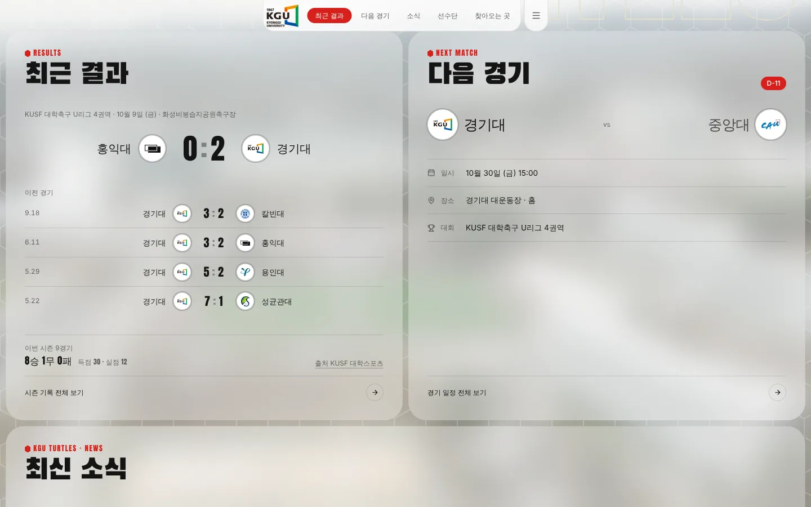
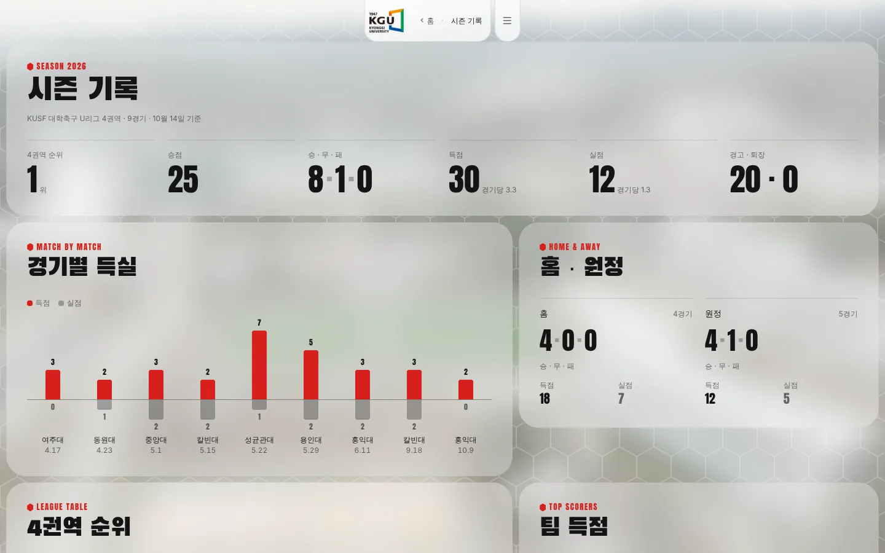
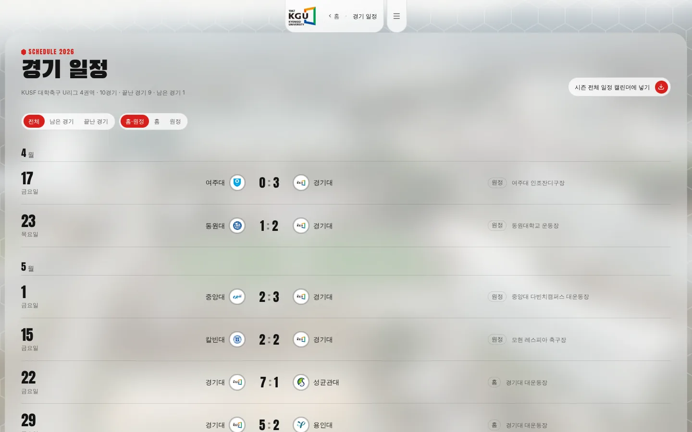
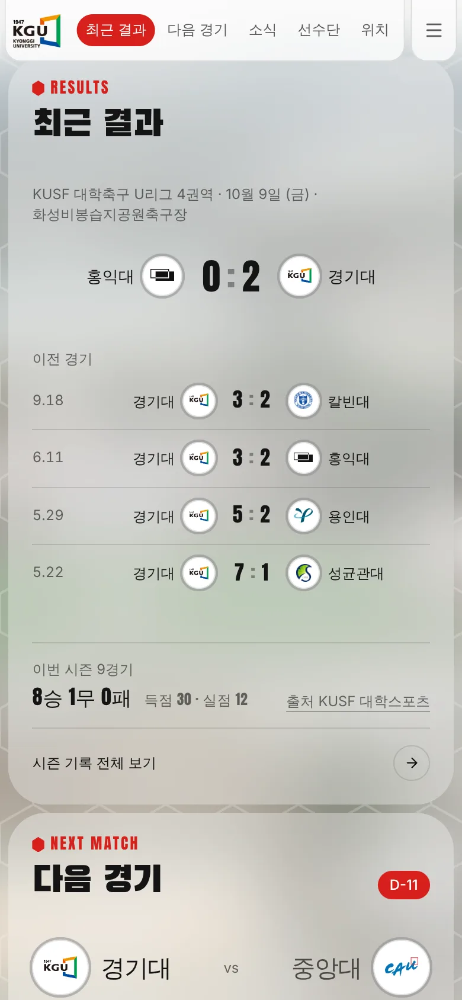
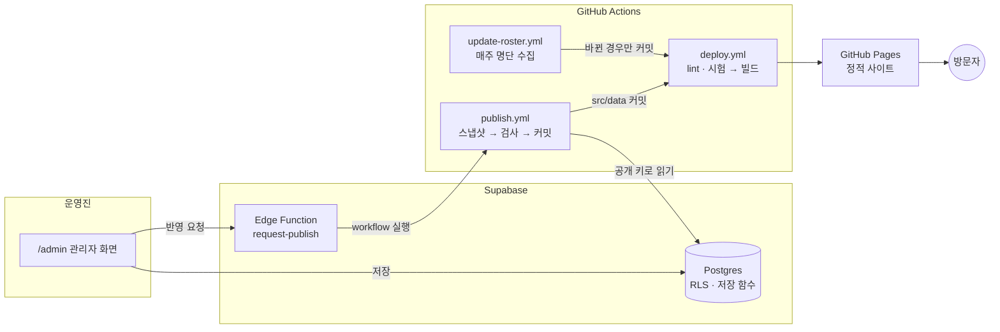

# KGU Football

경기대학교 축구부의 경기 일정·결과·시즌 기록·선수단·소식을 한곳에서 보는 **비공식 팬 사이트**다.
방문자용 정적 사이트와 운영진용 관리자 화면(Supabase)으로 나뉘며, 운영진이 입력한 자료는 GitHub Actions를 거쳐 사이트에 반영된다.
AI를 활용해 만든 개인 포트폴리오 프로젝트다.

**[사이트 보기 →](https://iin0ru.github.io/kgu_football/)**

| 홈 · 최근 결과 / 다음 경기 | 시즌 기록 |
|---|---|
|  |  |
| **경기 일정** | **휴대폰** |
|  |  |

## 주요 기능

**방문자 화면** (`/`, `/schedule`, `/records`)

- 홈: 최근 5경기 결과, 시즌 승무패·득실점, 한국 시간 기준 다음 경기·D-day, 블로그·매거진·유튜브, 포지션별 선수단, 홈 경기장 지도
- 경기 일정: 달별 목록, 남은·끝난·홈·원정 거르기, 구글 캘린더·`.ics`로 일정 넣기
- 시즌 기록: 4권역 순위표, 경기별 득실 막대 차트, 홈·원정 비교, 팀 득점 순위, 선수별 득점·도움·경고
- 스크롤에 반응하는 로고·고정 메뉴·카드 등장 효과, 동작 줄이기 설정과 키보드 접근 지원

**운영진 화면** (`/admin`, 공개 가입 없음)

- 이메일·비밀번호 로그인 후 경기·선수 기록·순위표·글을 입력하고 수정 기록을 확인
- KUSF 기록 페이지의 표를 그대로 복사해 붙여 넣으면 선수 기록·순위표로 읽어 들임
- 저장하지 않은 수정이 있으면 탭 이동·창 닫기 전에 확인
- 'DB 저장'과 '사이트 반영'을 나눠 보여 주고, 반영 요청 뒤 실제 사이트 버전이 따라잡을 때까지 상태를 표시

## 구조



방문자는 DB에 접속하지 않는다. 사이트는 저장소의 `src/data/*.json`으로 빌드된 정적 파일이라 DB에 문제가 생겨도 마지막으로 반영된 화면이 그대로 남는다.

## 설계하면서 정한 것

- **자료 정합성은 DB가 지킨다.** 관리자 화면을 거치지 않고 REST로 직접 써도, 경기대 선수 득점 합(+기록에 없는 득점)이 경기 점수와 같아야 하고 순위표 경기대 줄이 끝난 경기 결과와 맞아야 저장된다 (`supabase/migrations/0002_admin_integrity.sql`). 권한 검사(누가 쓸 수 있나)와 자료 검사(무엇이 맞나)를 분리했다.
- **비밀값은 브라우저와 저장소에 두지 않는다.** GitHub 토큰은 Edge Function의 비밀값으로만 두고, 함수가 DB의 `request_publish()`로 운영진인지 확인한 뒤에만 워크플로를 부른다. 60초 안의 중복 요청은 DB에서 거른다.
- **반영 실패를 복구할 수 있게 했다.** 커밋은 됐는데 배포가 실패한 경우, 다시 반영하면 공개 사이트의 버전 파일(`content-revision.json`)과 저장소 버전을 비교해 다시 배포한다. 6시간마다 자동으로 대조도 한다.
- **날짜는 방문자 위치와 상관없이 한국 시간이다.** D-day·다음 경기·캘린더 파일을 한국 시간으로 계산하고, 다른 시간대(`TZ=UTC` 등)에서 실행해도 같은 결과인지 시험한다.
- **수집은 허용된 곳만 한다.** 선수 명단은 robots.txt가 허용하는 KUFC 공개 페이지에서 주 1회 받고, 실패하거나 11명 미만이면 기존 명단을 유지한다. 막혀 있는 KUSF 기록은 사람이 확인해 넣는다.
- **방문자가 받는 코드를 줄였다.** 홈만 첫 파일에 담고 일정·기록·관리자 화면은 들어갈 때 불러온다. React·framer-motion은 따로 묶어, 사이트 코드만 바뀌면 라이브러리 파일은 다시 받지 않는다. Supabase 코드는 관리자 화면에만 들어간다.
- **라이선스를 확인할 수 없는 코드는 쓰지 않는다.** 첫 화면은 처음에 21st.dev 컴포넌트를 고쳐 썼으나 라이선스를 확인할 수 없어 직접 다시 작성했다. 이미지·로고는 출처와 사용 조건을 [`docs/SOURCES.md`](docs/SOURCES.md)에 기록한다. 선수 사진과 개인 정보는 쓰지 않는다.

## 기술

| 구분 | 사용 |
|---|---|
| 화면 | React 19, TypeScript, Vite 8, Tailwind CSS v4, react-router 7, framer-motion |
| 관리자·DB | Supabase (Postgres, Auth, Row Level Security, Edge Function · Deno) |
| 배포·자동화 | GitHub Actions 3개, GitHub Pages (`gh-pages` 브랜치) |
| 품질 | oxlint, 직접 작성한 시험 스크립트 (날짜·캘린더·시즌 기록·붙여넣기 파서·DB 권한) |

## 실행과 검증

Node.js 22를 권장한다 (GitHub Actions와 같은 버전).

```bash
npm ci
npm run dev        # 개발 서버
npm run build      # 타입 검사 + 배포용 빌드
npm run preview    # 빌드 결과 미리보기
```

`main`에 push하면 [`deploy.yml`](.github/workflows/deploy.yml)이 아래 검증을 모두 통과한 경우에만 빌드해 배포한다. 하나라도 실패하면 배포하지 않는다.

| 명령 | 확인하는 것 |
|---|---|
| `npm run lint` | 코드 규칙 (경고도 실패로 처리) |
| `npm run check:time` / `check:calendar` | 한국 시간 기준 날짜 표시, 캘린더 파일 |
| `npm run check:records` / `test:records` | 시즌 기록과 경기 점수·순위표가 서로 맞는지, 잘못된 자료를 막는지 |
| `npm run test:parse` | KUSF 표 붙여넣기 읽기 |
| `npm run test:db` | DB 권한·저장 함수 (로컬 Postgres·PostgREST 필요, 배포 시험에는 포함 안 함) |

관리자 화면과 DB 준비 순서는 [`docs/ADMIN_SETUP.md`](docs/ADMIN_SETUP.md)에 있다.

## 데이터

| 내용 | 파일 | 갱신 방식 |
|---|---|---|
| 경기 일정·결과 | `src/data/matches.json` | 관리자 화면 입력 → 사이트 반영 |
| 순위표·선수 경기 기록 | `src/data/records.json` | KUSF 표를 관리자 화면에 붙여 넣기 → 사이트 반영 |
| 블로그·매거진 | `src/data/posts.json` | 관리자 화면 입력 → 사이트 반영 |
| 선수 명단 | `src/data/roster.json` | KUFC 공개 페이지, 매주 월요일 03:00(한국 시간) 자동 |
| 유튜브·블로그 주소 | `src/data/home.ts` | 코드에서 직접 |
| 학교 로고·링크 | `src/data/teams.ts` | 공식 출처 확인 후 반영 |

## 문서와 개발 방식

- [개발 지침](CLAUDE.md): 작업 규칙과 검증 절차
- [디자인 기준](DESIGN.md): 확정된 화면과 움직임
- [프로젝트 노트](NOTES.md): 현재 상태·남은 작업·개발 로그·검토 기록
- [자료 출처](docs/SOURCES.md): 원문 링크와 사용 조건

AI를 활용해 개발했다. 기획·디자인 방향·자료·검수와 최종 결정은 본인이, 구현은 Claude가, 코드 리뷰는 GPT가 맡았다. 디자인 변경은 시안을 먼저 보고 승인한 뒤 적용했고, 결정과 이유는 `NOTES.md`에 남겼다.

## 고지

경기대학교 및 경기대학교 축구부와 관련이 없는 비공식 사이트다. 자료 출처와 사용 조건은 [`docs/SOURCES.md`](docs/SOURCES.md)에 기록한다.
